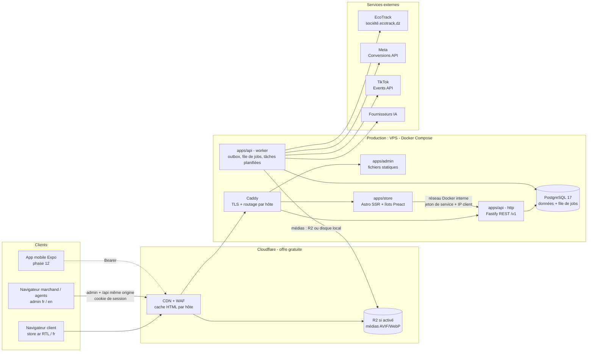
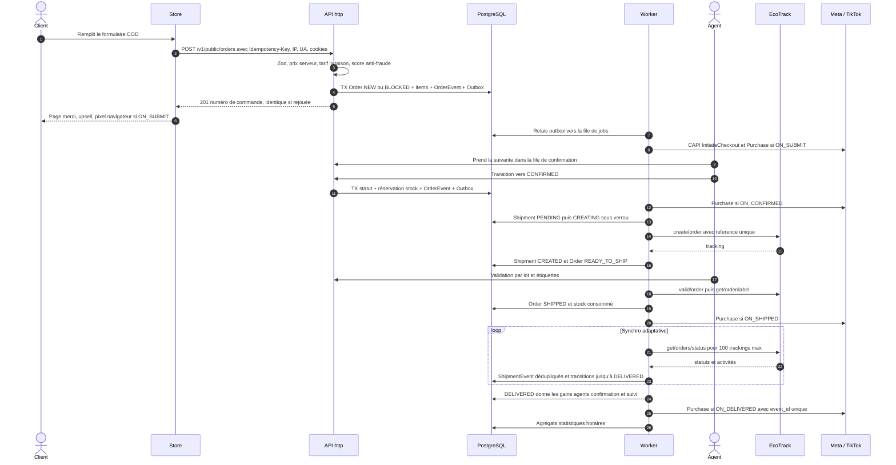
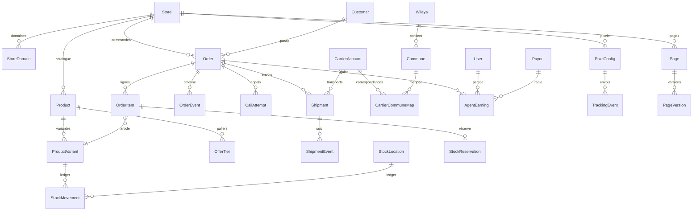
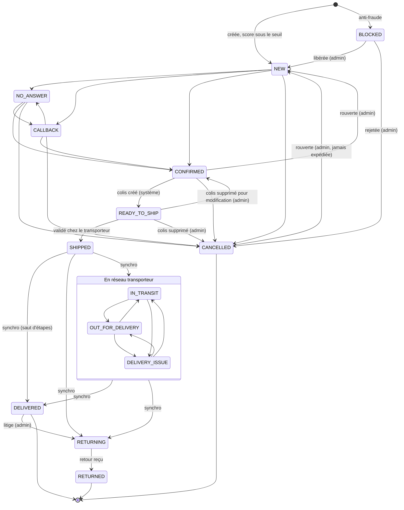

# ARCHITECTURE — DZ Commerce OS

> Version 1.0 — 2026-11-01 (session 1). Complète le PRD (fonctionnel) et les ADR
> (`docs/DECISIONS.md`). Toute divergence entre ce document et le code est un bug de doc ou de
> code : on corrige l'un ou l'autre, on ne laisse pas dériver.

## Sommaire
1. Vue d'ensemble (apps, packages, services, hébergement)
2. Flux principal de bout en bout
3. Modèle de données (vue d'ensemble, invariants, contraintes SQL ; schéma Prisma en annexe A)
4. Machine à états des commandes
5. Jobs, outbox, idempotence, retries, dead-letter
6. Sécurité
7. Tests et données de seed
8. Performance du store
9. Conventions d'API
10. Risques techniques et parades

---

## 1. Vue d'ensemble



Principes :
- **Le navigateur ne parle jamais aux services externes avec nos secrets.** Tous les appels
  transporteur, CAPI et IA partent du **worker**, déclenchés via l'outbox.
- Le **store** n'a aucun accès direct à la base : il lit le catalogue et crée les commandes via
  l'API, par le réseau interne (Docker en production, HTTPS en test), avec un jeton de service. Pour le navigateur, tout est de même
  origine : le formulaire poste sur `/api/orders` du store, qui relaie à l'API.
- L'**API** et le **worker** partagent le même code (services applicatifs) et ne diffèrent que par
  leur point d'entrée (ADR-0004).

### Structure du dépôt (cible)

```
apps/
  api/        Fastify (src/main-http.ts) + worker (src/main-worker.ts), modules par domaine
  admin/      SPA React + Vite (OMS, paramètres, builder)
  store/      Astro SSR + îlots Preact
  mobile/     Expo (phase 12)
packages/
  core/       env, logger (rédaction PII), erreurs, ids, crypto, argent, temps
  db/         schéma Prisma, migrations, client, seed, fabriques de test
  domain/     logique pure : machine à états, prix/offres, anti-fraude, gains, stock, RBAC
  contracts/  schémas Zod des DTO API (source de l'OpenAPI, partagés avec admin/store/mobile)
  carriers/   interface CarrierAdapter, EcoTrack, transporteur factice
  geo/        référentiel DZ, normalisation, rapprochement
  tracking/   construction des payloads Meta/TikTok, hachage
  blocks/     contrat des blocs de landing (schémas, migrations, champs d'éditeur)
  ai/         interface fournisseur IA, garde-fous
  config/     tsconfig, eslint, tailwind partagés
docs/         PRD, ARCHITECTURE, ROADMAP, DECISIONS, intégrations
```

Règles de dépendance (vérifiées par lint) :

| Package | Peut dépendre de | Interdit |
|---|---|---|
| `domain` | `core` (types, argent, temps) | Prisma, réseau, fichiers, horloge implicite (l'heure est injectée) |
| `carriers`, `tracking`, `ai` | `core`, `contracts` | Prisma, machine à états |
| `db` | `core` | `domain` |
| `apps/api` | tous les packages | autres apps |
| `apps/store` | `contracts`, `blocks`, `geo`, `core` | `db`, `domain`, `apps/*` |
| `apps/admin` | `contracts`, `blocks`, `core` (navigateur) | `db`, `apps/*` |

### Hébergement (ADR-0013)

Le diagramme ci-dessus décrit la **production** (VPS, fournisseur choisi avant P6). Au début,
un **environnement de test gratuit et non commercial** tourne sur Vercel.

**Test — Vercel Hobby + Neon Free (aucune vente réelle, aucune dépense publicitaire)**

| Composant | Où | Notes |
|---|---|---|
| `store` | projet Vercel `dzstore-store` (adaptateur Astro Vercel) | deux domaines gratuits `dzstore-beaute.vercel.app` et `dzstore-maison.vercel.app`, un par boutique de démo, résolus par l'hôte comme en production (ADR-0024, ADR-0025) ; mention « environnement de test » et `noindex` |
| `admin` | projet Vercel `dzstore-admin` (statique) | `/api/*` réécrit vers `dzstore-api.vercel.app` (ADR-0021) ; mention « environnement de test » |
| `api` | projet Vercel `dzstore-api` (une fonction Node 24) | bundle Vite produit au déploiement (ADR-0025) ; jobs en mode tick (ADR-0020) : `/v1/internal/tick` (planificateur externe, 30 min) et bouton « Système » de l'admin |
| PostgreSQL | Neon Free (intégration Vercel) | `DATABASE_URL` poolée pour l'application, `DATABASE_URL_UNPOOLED` directe pour les migrations appliquées au déploiement ; seed de démo à la demande (`SEED_ON_DEPLOY`) |
| médias | stockage objet gratuit via `MediaStorage` | — |
| transporteur | faux transporteur | EcoTrack réel seulement pour des essais ponctuels validés |

**Production — VPS + Cloudflare gratuit**

| Composant | Où | Notes |
|---|---|---|
| Caddy | VPS, conteneur | reverse proxy par hôte, TLS (certificat d'origine Cloudflare) ; seules les IP Cloudflare sont acceptées |
| `store` | VPS, conteneur | derrière Cloudflare, un domaine = une zone gratuite, cache HTML par hôte |
| `admin` | VPS, fichiers statiques servis par Caddy | `admin.<domaine principal>`, `/api` routé vers l'API (même origine) |
| `api-http` | VPS, conteneur | routes `/v1/public/*` exigeant le jeton de service |
| `api-worker` | VPS, conteneur | même image, commande différente, mode boucle ; aucune exposition HTTP sauf santé interne |
| PostgreSQL 17 | VPS, conteneur + volume persistant | jamais exposé ; `pg_dump` chiffré quotidien vers un stockage externe, rétention 30 j |
| médias | R2 (si activé) ou disque du VPS | `media.<domaine principal>` via le CDN, variantes immuables, cache long |
| supervision | sonde externe gratuite | alerte si le site ou l'API ne répondent plus |

Fournisseurs candidats : Oracle Cloud « Always Free » (gratuit, ARM64), Hostinger VPS, Hetzner.
Images construites pour `linux/amd64` et `linux/arm64` ; aucun code ne dépend d'un fournisseur.

---|---|---|
| Caddy | VPS Oracle Always Free (ARM64), conteneur | reverse proxy par hôte, TLS (certificat d'origine Cloudflare) ; seules les IP Cloudflare sont acceptées |
| `store` | VPS, conteneur | derrière Cloudflare, un domaine = une zone gratuite, cache HTML par hôte |
| `api-http` | VPS, conteneur | `api.<domaine principal>` via Cloudflare ; routes `/v1/public/*` exigeant le jeton de service |
| `api-worker` | VPS, conteneur | même image, commande différente ; aucune exposition HTTP sauf santé interne |
| PostgreSQL 17 | VPS, conteneur + volume persistant | jamais exposé ; `pg_dump` chiffré quotidien vers un stockage externe gratuit, rétention 30 j |
| admin | Cloudflare Pages | statique, `admin.<domaine principal>` |
| médias | R2 (si activé) ou disque du VPS | `media.<domaine principal>` via le CDN, variantes immuables, cache long |
| supervision | sonde externe gratuite | alerte si le site ou l'API ne répondent plus |

Repli : n'importe quel VPS Linux (Hostinger KVM, Hetzner…) avec le même `docker-compose`
et une restauration de sauvegarde ; aucun code ne dépend d'Oracle.

---

## 2. Flux principal de bout en bout



Points clés :
- La prise de commande **ne dépend d'aucun service externe** : si EcoTrack ou Meta sont en
  panne, les commandes continuent d'entrer ; les effets externes attendent dans les files.
- Chaque étape écrit sa trace dans `OrderEvent` (timeline) **dans la même transaction** que le
  changement d'état.
- Le déclencheur Purchase est **figé sur la commande** à sa création (`Order.purchaseTrigger`).

---

## 3. Modèle de données

**Schéma réel (source de vérité)** : `packages/db/prisma/schema.prisma` et ses migrations
(Prisma 7). Il contient les modèles déjà livrés ; chaque phase y ajoute les siens par migration.
L'**annexe A** reste le **modèle cible** (51 tables, 42 enums, validé avec Prisma 6.19) qui guide
les phases suivantes ; en cas d'écart, le schéma réel fait foi et l'annexe est mise à jour.

### Vue d'ensemble des entités centrales



### Invariants
- **Argent** : `Int` en DZD partout (prix, frais, gains, dépenses converties). Seuls les taux de
  change sont en `Decimal`.
- **Commande** : `total = subtotal + shippingPrice - discount` (vérifié par `CHECK`) ;
  `number` unique par boutique ; `(storeId, idempotencyKey)` unique ; `version` incrémentée à
  chaque modification (verrou optimiste).
- **Instantanés** : `OrderItem.unitPrice`, `unitCost`, `title` et `Order.costOfGoods` sont figés à
  la commande ; modifier le catalogue ne change pas l'historique.
- **Envoi** : au plus **un** `Shipment` actif par commande ; `reference` unique par compte
  transporteur.
- **Ledgers** : `StockMovement` et `AgentEarning` sont en insertion seule (pas d'`UPDATE`
  métier ni de `DELETE`), sauf rattachement d'un gain à un paiement (`payoutId`), une seule fois.
- **Pixels** : `(pixelConfigId, eventName, eventId)` unique.
- **Secrets** : uniquement dans `Secret` (chiffrés) ; aucune autre table ne contient de jeton.
- **Données personnelles** : concentrées dans `Order`, `Customer`, `Session` (IP tronquée) ;
  jamais dans `AuditLog.meta`, `OutboxEvent.payload` (identifiants seulement) ni dans les logs.

### Contraintes ajoutées en SQL dans les migrations (non exprimables en Prisma)

| Objet | Contrainte |
|---|---|
| `Shipment` | `UNIQUE ("orderId") WHERE "isActive"` — un seul envoi actif par commande |
| `StoreDomain` | `UNIQUE ("storeId") WHERE "isPrimary"` — un seul domaine principal |
| `OrderItem` | `UNIQUE ("orderId", "upsellId") WHERE "upsellId" IS NOT NULL` — upsell accepté une fois |
| `FunnelDaily` | `UNIQUE NULLS NOT DISTINCT (date, "storeId", "productId", source)` |
| `Order` | `CHECK (total = subtotal + "shippingPrice" - discount AND total >= 0)` |
| `StockLevel` | `CHECK (reserved >= 0)` ; `onHand >= 0` sauf réglage explicite |
| `AgentEarning` | `CHECK ((kind = 'ACCRUAL' AND amount > 0) OR (kind = 'REVERSAL' AND amount < 0))` |
| `OrderItem` | `CHECK (quantity > 0 AND "unitPrice" >= 0 AND "lineTotal" = quantity * "unitPrice")` |
| Recherche | index trigramme (`pg_trgm`) sur `Order.customerName` ; recherche téléphone par préfixe normalisé |
| Limitation de débit | table `UNLOGGED rate_limit_bucket` gérée en SQL brut |
| `User` | `CHECK ("failedTwoFactorCount" >= 0)` (compteur d'échecs 2FA, verrouillage au plafond) |

### Index : justification des principaux
- `Order(storeId, status, createdAt)` : liste OMS filtrée par statut, triée par date.
- `Order(status, callbackAt)` : file de confirmation (rappels échus).
- `Order(phone, createdAt)` : doublons et vélocité anti-fraude.
- `Order(assignedConfirmerId, status)`, `Order(confirmedById, confirmedAt)` : dashboards agents.
- `Shipment(status, nextSyncAt)` : sélection des colis à synchroniser.
- `OrderEvent(toStatus, createdAt)` : statistiques de transitions par période.
- `StoreEvent(storeId, type, createdAt)` : agrégation funnel (rétention 90 jours).

---

## 4. Machine à états des commandes



Une nouvelle tentative sans réponse ou un rappel reprogrammé **n'est pas une transition** : c'est
un événement (`CALL_ATTEMPT`) qui incrémente `noAnswerCount` ou déplace `callbackAt`.

### Transitions, acteurs et effets

Acteurs : **C** = agent confirmation (verrou détenu), **S** = agent suivi, **A** = OWNER/ADMIN,
**SYS** = système (job, synchro transporteur), **CLI** = client via le store.

| De | Vers | Qui | Préconditions | Effets (même transaction, puis outbox) |
|---|---|---|---|---|
| — | `NEW` | CLI | entrées valides, décision ≠ BLOCK | `Customer` créé/maj, `OrderEvent CREATED`, outbox `order.created` (pixels si `ON_SUBMIT`, funnel) |
| — | `BLOCKED` | SYS | décision BLOCK ou liste noire | `OrderEvent FRAUD_EVALUATED` ; **aucun pixel** |
| `BLOCKED` | `NEW` | A | motif | audit ; recalcul doublon |
| `BLOCKED` | `CANCELLED` | A | motif (défaut `FAKE`) | — |
| `NEW`, `CALLBACK` | `NO_ANSWER` | C, A | `CallAttempt` | `noAnswerCount++`, prochaine tentative planifiée |
| `NEW`, `NO_ANSWER` | `CALLBACK` | C, A | `callbackAt` futur | — |
| `NEW`, `NO_ANSWER`, `CALLBACK` | `CONFIRMED` | C, A | adresse complète, tarif actif, palier/variantes valides | `confirmedBy/At`, réservation stock (P7), outbox `order.confirmed` → création colis (si auto), Purchase si `ON_CONFIRMED` |
| `NEW`, `NO_ANSWER`, `CALLBACK` | `CANCELLED` | C, A ; SYS (auto après N tentatives si activé) | motif obligatoire | `Customer.cancelledCount++` |
| `CONFIRMED` | `CANCELLED` | C, A | aucun envoi actif | libération réservation |
| `CONFIRMED` | `NEW` | A | aucun envoi actif | libération réservation ; audit |
| `CONFIRMED` | `READY_TO_SHIP` | SYS | `Shipment` passé `CREATED` | tracking enregistré |
| `READY_TO_SHIP` | `SHIPPED` | SYS (job validation lancé par A ou auto) | `valid/order` réussi | sortie de stock (P7), Purchase si `ON_SHIPPED` |
| `READY_TO_SHIP` | `CONFIRMED` / `CANCELLED` | A | `delete/order` réussi | `Shipment CANCELLED`, inactif |
| `SHIPPED`, réseau | `IN_TRANSIT`, `OUT_FOR_DELIVERY`, `DELIVERY_ISSUE` | SYS ; A (forcé, motif) | mapping statut transporteur | `DELIVERY_ISSUE` → file de suivi |
| `SHIPPED`, réseau | `DELIVERED` | SYS ; A (forcé, motif) | — | gains agents, `Customer.deliveredCount++`, Purchase si `ON_DELIVERED` |
| `SHIPPED`, réseau | `RETURNING` | SYS ; A (forcé, motif) | — | file de suivi (retour) |
| `RETURNING` | `RETURNED` | SYS (`retour_recu`) ; A (réception constatée) | — | entrée en stock (P7), `valid/returns`, `Customer.returnedCount++` |
| `DELIVERED` | `RETURNING` | A uniquement | motif (litige) | contre-passation des gains |
| `CANCELLED` | `NEW` | A | jamais expédiée | audit |

Règles :
- Table des transitions dans `packages/domain/orders/transitions.ts`, testée **exhaustivement** :
  chaque couple (état, état) × acteur a un résultat attendu (autorisé / refusé).
- La synchro transporteur ne fait **jamais reculer** une commande hors du groupe « réseau » :
  un statut transporteur incohérent (ex. `en_livraison` après `DELIVERED`) est enregistré dans
  la timeline et **signalé**, sans transition.
- Une transition demandée vers l'état actuel est un **no-op idempotent** (double clic, rejeu de
  job) ; une `version` périmée renvoie `409 CONFLICT`.
- Transition forcée : OWNER/ADMIN, **uniquement** entre statuts d'expédition, motif obligatoire,
  audit.

---

## 5. Jobs, outbox, idempotence, retries, dead-letter

### Outbox transactionnelle
1. Le service métier écrit `OutboxEvent(type, aggregateId, payload=identifiants)` **dans la
   transaction** du changement d'état. Annulation de la transaction ⇒ pas d'événement.
2. Le **relais** (ADR-0023) prend un événement `PENDING` dû (`FOR UPDATE SKIP LOCKED`) et, dans
   **une seule transaction**, crée un job par abonné (clé `outbox:<id>` unique par file) puis
   marque l'événement `DISPATCHED` : diffusion **exactement une fois**, plusieurs relais
   simultanés traitent des événements disjoints.
3. En cas d'échec du relais : `attempts++`, `availableAt` repoussé (backoff) ; au-delà de 10
   essais ⇒ `FAILED` + alerte.
4. Exécution des jobs : **au moins une fois** (un worker peut disparaître après l'effet et avant
   l'acquittement ; le bail expiré rend le job à nouveau disponible) ⇒ tous les handlers sont
   **idempotents** (tableau ci-dessous). Purge des `DISPATCHED` après 30 jours.
5. Toutes les dates de la file (`runAt`, `availableAt`, bail) viennent de l'horloge de
   l'application, jamais de l'horloge de la base : une seule source de temps.

### Deux modes d'exécution (ADR-0020)
- **Boucle** (production) : le worker appelle `runTick()` en continu (relais outbox + jobs dus).
- **Tick** (test sur Vercel) : `runTick({ budgetMs })` est appelé après la réponse HTTP qui a
  produit des événements, et par `/v1/internal/tick` (secret partagé ; des ticks simultanés
  traitent des jobs disjoints). Les tâches planifiées (synchro des colis, rollups) sont rattrapées au tick
  suivant d'après leur échéance en base. Mêmes handlers et mêmes garanties dans les deux modes.

### Files

| File | Source | Concurrence | Notes |
|---|---|---|---|
| `carrier:<compteId>` | création, validation, suppression, synchro, référentiels | **1 job actif à la fois** par compte | tous les appels d'un compte passent par là ; priorité création/validation > synchro |
| `shipment.reconcile` | envoi `UNKNOWN` | via `carrier:<compteId>` | voir ci-dessous |
| `tracking.send` | transitions déclencheuses, vues | 5 | Meta et TikTok |
| `earnings.apply` | `DELIVERED`, sortie de `DELIVERED` | 5 | gains et contre-passations |
| `stock.apply` | `CONFIRMED`, `SHIPPED`, `RETURNED`, `CANCELLED` | 5, verrou par variante | mouvements + `StockLevel` |
| `media.process` | téléversement | 2 | variantes AVIF/WebP |
| `stats.rollup` | cron horaire | 1 | `FunnelDaily`, agrégats |
| `ai.generate` | action utilisateur | 2 | plafond mensuel vérifié avant appel |
| `maintenance.*` | crons | 1 | purge sessions, clés d'idempotence, `StoreEvent` > 90 j, anonymisation > 12 mois, réconciliation ledger |

La sérialisation « 1 job actif par compte transporteur » repose sur la **clé de concurrence** de
la file (`concurrencyKey = carrier:<compteId>`), garantie par un index unique partiel
(un seul job `RUNNING` par clé, ADR-0023).

### Idempotence

| Opération | Garantie |
|---|---|
| Création de commande | `UNIQUE (storeId, idempotencyKey)` ; un rejeu renvoie la commande existante (même statut HTTP) |
| Upsell accepté | index unique partiel `(orderId, upsellId)` |
| Transition de statut | table des transitions + `version` ; même état cible = no-op |
| Création de colis | `Shipment` créé **avant** l'appel ; un seul actif par commande ; `reference` unique ; réconciliation en cas d'ambiguïté |
| Événement transporteur | `UNIQUE (shipmentId, dedupeKey)` |
| Événement pixel | `UNIQUE (pixelConfigId, eventName, eventId)` |
| Gain agent | `UNIQUE (orderId, userId, role, kind)` |
| Mouvement de stock | `idempotencyKey` unique (`<type>:<shipmentId ou orderItemId>`) |
| Actions groupées admin | en-tête `Idempotency-Key` → table `IdempotencyKey` (24 h) |

### Création de colis sans doublon (algorithme)
1. Transaction : vérifier qu'il n'existe aucun envoi actif ; créer `Shipment(PENDING, reference)`.
2. Job `carrier:<compte>` : passer `CREATING` (verrou), appeler `create/order`.
3. Réponse `success:true` ⇒ `CREATED` + tracking. Réponse 422 / `10002` ⇒ `FAILED` + message
   actionnable (aucun retry). Réponse **ambiguë** (timeout après envoi, connexion coupée, 5xx)
   ⇒ `UNKNOWN`.
4. `UNKNOWN` ⇒ réconciliation : `get/orders` sur la date de création (pages de 40), recherche de
   `reference` **exacte**. Trouvé ⇒ `CREATED` avec ce tracking. Absent après deux passes espacées
   de 2 min ⇒ nouvel essai de création (étape 2). Toute autre situation ⇒ revue humaine.
5. Jamais de création si un envoi du même ordre est `CREATING` ou `UNKNOWN`.

### Retries et dead-letter

| Erreur | Classe | Traitement |
|---|---|---|
| Réseau avant envoi (DNS, connexion refusée) | rejouable | backoff |
| Timeout ou coupure **après** envoi, 5xx sur une écriture | ambiguë | `UNKNOWN` → réconciliation (création) ; relecture d'état avant de rejouer (validation, suppression) |
| 429 | quota | attente `Retry-After` (non compté comme échec), file du compte en pause |
| 401, `INVALID_TOKEN`, `TOKEN_NOT_ALLOWED` | configuration | file du compte en pause + alerte, pas de retry |
| 422, `10001`, `10002`, `10003` | définitive | état `FAILED` + message, pas de retry |
| Erreur de schéma de réponse | anomalie | DLQ immédiate + alerte (le contrat a changé) |

- Backoff : `min(30 s × 2^n, 1 h)` ± 20 % de jitter ; 8 essais (≈ 4 h) puis **DLQ**.
  Pixels : fenêtre de retry ≤ 48 h (fraîcheur exigée par les plateformes).
- DLQ visible dans l'admin (« Jobs en échec ») : payload (sans PII), dernière erreur, essais ;
  actions **relancer** (même idempotence) ou **abandonner** (avec motif, audité).
- Alertes : DLQ non vide, envois `FAILED`, quota transporteur > 80 %, relais outbox en retard
  de plus de 2 min.

### Limite de taux transporteur
- Budget interne 40 req/min, 1 400/h, 14 000/jour par compte. Limiteur à jetons dans le job du
  compte + état persistant (restant et réinitialisation lus dans les en-têtes `X-RateLimit-*`
  après chaque appel) pour survivre aux redémarrages.
- Synchro **adaptative** (`Shipment.nextSyncAt`) :

| État de l'envoi | Fréquence |
|---|---|
| `CREATED` (non validé) | 6 h |
| `VALIDATED`, `IN_TRANSIT` | 60 min |
| `OUT_FOR_DELIVERY`, `ISSUE` | 20 min |
| `RETURNING` | 2 h |
| `DELIVERED` non payé | 12 h jusqu'à `PAID` |
| sans changement depuis 10 j | 12 h + alerte |
| terminaux (`RETURNED`, payé, `CANCELLED`) | arrêt |

  Requêtes groupées par 100 trackings (`get/orders/status`) : 10 000 colis actifs ≈ 300 à
  400 requêtes/heure, sous le plafond.

---

## 6. Sécurité

### Authentification et sessions (ADR-0007)
- Argon2id (paramètres OWASP actuels) ; jeton de session de 256 bits, **haché** en base ; cookie
  `__Host-` `HttpOnly; Secure; SameSite=Lax` pour l'admin, Bearer pour le mobile.
- Expiration glissante 12 h (agents) / 7 jours (OWNER sur appareil de confiance), absolue 30 jours ;
  révocation immédiate (changement de mot de passe, désactivation, « déconnecter partout »).
- 2FA TOTP obligatoire OWNER/ADMIN, secret dans `Secret`, codes de secours hachés.
- Verrouillage progressif après échecs ; messages non énumérants ; journal des connexions.

### Autorisation (ADR-0008)

| Permission (extrait) | OWNER | ADMIN | Agent confirmation | Agent suivi |
|---|---|---|---|---|
| `orders.read` | tout | tout | sa file + ses commandes | ses colis suivis + sa file |
| `orders.confirm` (transitions de confirmation) | ✓ | ✓ | ✓ | — |
| `orders.edit` (avant validation transporteur) | ✓ | ✓ | champs livraison et articles | — |
| `orders.followup` (remarques transporteur, demande de retour) | ✓ | ✓ | — | ✓ |
| `orders.forceStatus` | ✓ | ✓ | — | — |
| `shipments.manage` (créer, valider, supprimer, étiquettes) | ✓ | ✓ | — | — |
| `blacklist.add` / `blacklist.remove` | ✓ / ✓ | ✓ / ✓ | ✓ / — | — |
| `catalog.write`, `settings.write`, `pages.publish` | ✓ | ✓ | — | — |
| `finance.read` (coûts, profit, pub) | ✓ | ✓ | — | — |
| `stock.adjust`, `payouts.manage` | ✓ | ✓ | — | — |
| `earnings.readOwn` | — | — | ✓ | ✓ |
| `users.manage` | ✓ | ✓ (sauf OWNER) | — | — |
| `secrets.write` (jamais de lecture en clair) | ✓ | ✓ | — | — |

- Chaque route déclare `permission` + `scope` ; un test parcourt **toutes** les routes de
  l'OpenAPI × tous les rôles. Une route sans déclaration **fait échouer le démarrage**.
- Périmètre boutique appliqué dans la couche d'accès aux données (filtre `storeId IN (...)`
  obligatoire), pas seulement dans les contrôleurs.
- Champs sensibles retirés par sérialiseurs dédiés selon la permission (`finance.read`).

### Secrets (ADR-0009)
- AES-256-GCM, IV aléatoire de 96 bits, clé maître `APP_ENCRYPTION_KEYS` (versions multiples,
  la plus récente chiffre, toutes déchiffrent) ; rotation = job de re-chiffrement + audit.
- Les secrets ne sortent jamais de l'API (affichage `••••1234`), ne sont jamais journalisés,
  jamais placés dans `OutboxEvent` ou un payload de job (on y met l'identifiant du compte).

### Confiance store ↔ API
- Routes `/v1/public/*` acceptées **uniquement** avec l'en-tête de jeton de service
  `x-dz-service-token` (secret partagé `STORE_SERVICE_TOKEN`, comparaison à temps constant,
  règle d'accès `service` ; aucune session utilisateur ne le remplace) ; l'IP client est lue dans `X-Client-IP` fourni par le
  store (lui-même depuis `CF-Connecting-IP`), jamais depuis la requête brute.

### Limitation de débit (en plus des règles WAF Cloudflare)

| Point d'entrée | Limite par défaut |
|---|---|
| Création de commande | 5/min et 20/h par IP ; 3/h par téléphone (au-delà : refus générique) |
| Événements funnel | 60/min par IP |
| Connexion | 5 / 15 min par compte, 20 / 15 min par IP, verrouillage progressif |
| Vérification 2FA | 5 / 5 min par session |
| API authentifiée | 600/min par utilisateur |

### En-têtes et protections web
- HSTS (préchargement), `X-Content-Type-Options`, `Referrer-Policy: strict-origin-when-cross-origin`,
  `Permissions-Policy` restrictive.
- **CSP store** (ADR-0024) : hachages calculés par Astro pour scripts et styles (pas de nonce :
  le HTML est partagé par le cache CDN), `default-src 'self'` + domaines officiels des pixels
  Meta et TikTok uniquement (phase pixels) ; `frame-ancestors` = origine admin (aperçu du
  builder, `STORE_FRAME_ANCESTORS`) sinon `'none'` ; ni `unsafe-inline` ni `unsafe-eval`.
- **Store multi-domaine** (ADR-0024) : boutique résolue depuis l'en-tête `Host` brut, jamais
  `X-Forwarded-Host` (empoisonnement du cache CDN, R9).
- **CSP admin** : `default-src 'self'`, `connect-src` = API, `frame-src` = domaines des boutiques
  (aperçu), `frame-ancestors 'none'`.
- CSRF : admin et API sur la même origine (ADR-0021), cookie `SameSite=Lax` + en-tête
  personnalisé obligatoire sur toute mutation ; CORS fermé (aucune origine tierce autorisée).
- Exports CSV : neutralisation des cellules commençant par `= + - @` (injection de formules).

### Audit
Connexions et échecs, 2FA, gestion des utilisateurs et rôles, transitions forcées,
annulations, modifications de prix/tarifs, liste noire, secrets (création, rotation), pixels,
paiements, ajustements de stock, exports, relances et abandons de jobs, publication de pages.
`AuditLog` en insertion seule, consultable et filtrable par OWNER/ADMIN.

### Chaîne d'approvisionnement et exploitation
Lockfile commité, `pnpm audit` en CI, mises à jour groupées hebdomadaires (Renovate ou
Dependabot), images Docker épinglées par digest, sauvegardes chiffrées et restauration testée
(P6, puis à chaque checkpoint majeur).

---

## 7. Tests et données de seed

### Pyramide

| Niveau | Outils | Portée | Exemples obligatoires |
|---|---|---|---|
| Unitaire | Vitest | `domain`, `geo`, `carriers` (sérialisation, mapping), `tracking` (payloads, hachage), `core`, `blocks` | transitions exhaustives état × état × acteur ; chaque signal anti-fraude ; résolution des barèmes ; calcul des prix et paliers ; normalisation arabe/latine ; mapping de chaque statut EcoTrack, y compris inconnu et accentué |
| Intégration API | Vitest + Fastify `inject` + **PostgreSQL réel** | routes, RBAC, transactions, contraintes | matrice routes × rôles ; double soumission ⇒ 1 commande ; deux agents sur la même commande ⇒ 1 seul verrou ; transition interdite ⇒ 409/403 ; contraintes SQL (`CHECK`, unicités) |
| Jobs | Vitest + file de jobs réelle (PostgreSQL) + HTTP simulé (`undici` MockAgent) | outbox, retries, DLQ, transporteur | timeout après envoi ⇒ `UNKNOWN` ⇒ réconciliation ⇒ zéro doublon ; 429 + `Retry-After` ; token invalide ⇒ pause ; rejeu d'un job pixel ⇒ un seul envoi |
| Contrat | fixtures issues des exemples du snapshot EcoTrack et des docs Meta/TikTok consignées | adaptateurs | chaque exemple officiel parsé sans erreur |
| E2E | Playwright | parcours complets | store ar/fr mobile/desktop → commande → confirmation au clavier → envoi (transporteur factice) → synchro jusqu'à livrée → gain visible dans le dashboard agent |
| Performance | Lighthouse CI | pages store | budgets PRD §7 bloquants en CI |
| Charge (P6) | k6 ou autocannon | création de commande, liste OMS, synchro | objectifs PRD §23 |

- **Base de test** : une base modèle migrée une fois, puis une base clonée (`CREATE DATABASE …
  TEMPLATE …`) par processus de test, tables vidées entre fichiers. Aucun mock de Prisma.
- **Temps** : horloge injectée dans `domain` et dans les services (tests déterministes sur les
  fenêtres de vélocité, rappels et expirations).
- **Réseau** : interdit en test (échec si une requête sort sans être simulée).
- Une correction de bug commence par un test qui échoue (skill `bug`).

### Données de seed (déterministes, fictives)
- 2 boutiques (`demo-beaute` en `ar`+`fr`, `demo-maison`), domaines locaux
  `beaute.localhost`, `maison.localhost`.
- Utilisateurs : OWNER (2FA préenrôlée en dev), ADMIN, 2 agents confirmation, 1 agent suivi,
  1 agent mixte ; mots de passe de démo documentés, **refus du seed en production**.
- Référentiel complet des wilayas/communes (P1), tarifs pour toutes les wilayas.
- 6 produits (variantes couleur/taille, paliers 1/2/3, un upsell), médias de démonstration libres
  de droits.
- Compte transporteur **factice** + correspondances géo complètes.
- 300 commandes réparties sur 60 jours dans tous les statuts avec une distribution réaliste
  (≈ 65 % confirmées, 80 % de livraison), appels, envois et événements transporteur, quelques
  doublons, commandes bloquées, gains et un paiement — de quoi tester les écrans et statistiques.
- Téléphones manifestement fictifs (`+21355500xxxx`), noms générés, aucune donnée réelle.

---

## 8. Performance du store

- HTML identique pour tous les visiteurs ⇒ cacheable au CDN :
  `Cache-Control: public, s-maxage=300, stale-while-revalidate=86400`, clé de cache incluant
  l'hôte ; purge ciblée par URL (job) à la publication d'une page, au changement de prix, de stock
  « épuisé » ou de tarif.
- Données dynamiques **dans** la page : tarifs de livraison de la boutique sérialisés en JSON
  compact (≈ 58 entrées) ; référentiel des communes chargé par l'îlot du formulaire à la première
  interaction (fichier statique versionné, cache long), jamais en bloquant le rendu.
- Le serveur recalcule tout à la commande : un HTML en cache légèrement périmé ne peut pas faire
  payer un mauvais prix ; en cas d'écart, la commande est créée au prix serveur et l'écart est
  affiché sur la page merci.
- Pixels chargés après interaction ou au repos ; aucun script tiers dans le chemin critique ;
  polices arabes auto-hébergées sous-ensemblées.
- Budgets vérifiés en CI (ADR-0014) : LCP < 2,5 s, CLS < 0,1, INP < 200 ms, JS initial < 50 Ko
  gzip, Lighthouse mobile ≥ 90.

---

## 9. Conventions d'API

- REST JSON, préfixe `/v1` ; `/v1/public/*` pour le store (jeton de service), le reste authentifié.
- Erreur uniforme : `{ "error": { "code": "ORDER_TRANSITION_FORBIDDEN", "message": "…",
  "details": {…}, "requestId": "…" } }` ; codes stables, messages traduits côté client.
- Pagination par curseur (`?cursor=&limit=` ≤ 200) ; filtres explicites ; tri whitelisté.
- Concurrence : `If-Match: <version>` sur les mutations de commande → `409` si périmée.
- `Idempotency-Key` accepté sur les POST sensibles (création de commande, actions groupées).
- Dates ISO 8601 UTC ; montants en entiers DZD ; identifiants UUIDv7.
- OpenAPI générée depuis `packages/contracts`, publiée hors production, base du client mobile.

---

## 10. Risques techniques et parades

| # | Risque | Impact | Parade |
|---|---|---|---|
| R1 | Colis créé en double après un timeout | argent, logistique | `Shipment` avant appel, un actif par commande, `reference` unique, réconciliation avant tout nouvel essai, file sérialisée par compte |
| R2 | Doc EcoTrack incomplète ou divergente selon les sociétés (🔶, accents, fautes de clés) | envois refusés, statuts mal lus | snapshot daté, normalisation, schémas tolérants, statut inconnu = signalé jamais deviné, vérification sur le compte réel au checkpoint 4 |
| R3 | Commune mal convertie (arabe → nom transporteur) | colis refusé ou mal livré | référentiel canonique, correspondances validées humainement, blocage avant appel si non mappée |
| R4 | Quota transporteur dépassé (50/min) | synchro et créations bloquées | file unique par compte, budget 80 %, lecture des en-têtes, synchro adaptative par lots de 100 |
| R5 | Perte d'attribution pixels quand Purchase part tard (livraison plusieurs jours après le clic) | optimisation pub dégradée | capture `fbp/fbc/ttclid/ttp` à la soumission, envoi immédiat au déclencheur, `InitiateCheckout` toujours envoyé, déclencheur réglable par boutique et mesuré |
| R6 | Double `Purchase` ou données non hachées envoyées | mesure faussée, conformité | unicité en base, payloads construits par fonctions pures testées, revue au checkpoint 5 |
| R7 | Afflux de fausses commandes ou robots | coût d'appels, stock bloqué | WAF + limites de débit + pot de miel + score + liste noire + blocage silencieux |
| R8 | Régression de performance du store (scripts, images) | conversion | budgets Lighthouse bloquants en CI, pixels différés, pipeline d'images |
| R9 | Cache CDN servant la boutique A sur le domaine B | grave (image, prix) | clé de cache incluant l'hôte, tests e2e multi-hôtes, en-tête `Vary` correct, purge par URL complète |
| R10 | Concurrence (deux agents, synchro pendant une édition) | incohérences | verrou de commande avec TTL, verrou optimiste `version`, transitions centralisées |
| R11 | Dérive du stock (transporteur vs ledger) | ruptures ou survente | ledger immuable, `StockLevel` transactionnel, réconciliation quotidienne, rapprochement `get/products/list` |
| R12 | Fuite de jeton (le token EcoTrack est en query string pour `get/orders/status`) | compromission du compte transporteur | URL journalisées sans query string, rédaction pino, secrets chiffrés, rotation documentée |
| R13 | Perte de données (serveur gratuit sans SLA, disque unique) | critique | `pg_dump` chiffré quotidien vers un stockage externe, rétention 30 jours, restauration testée à chaque checkpoint majeur |
| R14 | Dérive du projet entre sessions IA (contexte perdu) | qualité | `PROGRESS.md`, ADR, skills, tests comme filet, checkpoints avec revue |
| R15 | IA produisant des contenus trompeurs ou coûteux | légal, réputation, coût | brouillons uniquement, consignes système, validation par schéma, plafond mensuel |
| R16 | Fuseau horaire mal géré (stats, « aujourd'hui ») | chiffres faux | UTC en base, agrégation en `Africa/Algiers`, tests aux bornes de minuit |
| R17 | Offre gratuite modifiée ou retirée (Vercel Hobby, Neon Free, Oracle Always Free) ou instance récupérée | environnement hors ligne | code portable (adaptateurs par configuration), Docker Compose, sonde externe, sauvegardes : bascule vers une autre cible sans réécriture |
| R20 | Test sur Vercel utilisé pour de vraies ventes (interdit par les conditions Hobby) | compte suspendu | règle ADR-0013 : production sur VPS avant toute vente réelle, rappel dans la checklist de mise en ligne (P6) |
| R19 | Incompatibilité ARM64 d'une dépendance | blocage au déploiement | vérification arm64 en P0, CI construisant les images arm64 |
| R18 | Évolution du découpage administratif (nouvelles wilayas) | formulaire et mapping obsolètes | référentiel en données, aucun code en dur, resynchro transporteur |

---

## Annexe A — Schéma Prisma (premier jet)

> Validé avec `prisma validate` (Prisma 6.19.3) le 2026-11-01. L'en-tête `generator` /
> `datasource` sera adapté à la version de Prisma retenue en P0-04, et le schéma découpé par
> domaine. Les contraintes SQL complémentaires sont listées au §3.

```prisma
// DZ Commerce OS — modèle de données, premier jet (session 1).
// Conventions : UUIDv7, montants Int en DZD, timestamptz UTC, JSON validé par Zod.
// Contraintes non exprimables en Prisma (index partiels, CHECK) : voir ARCHITECTURE §3.

generator client {
  provider = "prisma-client-js"
}

datasource db {
  provider = "postgresql"
  url      = env("DATABASE_URL")
}

// ─────────────────────────────── Enums ───────────────────────────────

enum Role {
  OWNER
  ADMIN
  CONFIRMATION_AGENT
  FOLLOWUP_AGENT
}

enum Locale {
  ar
  fr
  en
}

enum SessionKind {
  WEB
  MOBILE
}

enum ActorType {
  USER
  SYSTEM
  CARRIER
  CUSTOMER
}

enum SecretKind {
  CARRIER_TOKEN
  PIXEL_ACCESS_TOKEN
  AI_API_KEY
  TOTP_SECRET
  OTHER
}

enum OutboxStatus {
  PENDING
  DISPATCHED
  FAILED
}

enum DeliveryType {
  HOME
  STOP_DESK
}

enum CarrierProvider {
  ECOTRACK
  FAKE
}

enum CarrierService {
  DELIVERY
  PICKUP
  EXCHANGE
  COLLECTION
  RETURN
}

enum GeoMatchMethod {
  EXACT
  NORMALIZED
  FUZZY
  MANUAL
}

enum ProductStatus {
  DRAFT
  ACTIVE
  ARCHIVED
}

enum MediaStatus {
  PROCESSING
  READY
  FAILED
}

enum UpsellKind {
  POST_SUBMIT
  IN_FORM
}

enum BlacklistType {
  PHONE
  IP
  DEVICE
}

enum OrderStatus {
  NEW
  NO_ANSWER
  CALLBACK
  CONFIRMED
  READY_TO_SHIP
  SHIPPED
  IN_TRANSIT
  OUT_FOR_DELIVERY
  DELIVERY_ISSUE
  DELIVERED
  RETURNING
  RETURNED
  CANCELLED
  BLOCKED
}

enum CancelReason {
  CUSTOMER_REFUSED
  UNREACHABLE
  WRONG_NUMBER
  DUPLICATE
  FAKE
  OUT_OF_STOCK
  PRICE_TOO_HIGH
  SHIPPING_TOO_EXPENSIVE
  CHANGED_MIND
  ORDERED_ELSEWHERE
  OTHER
}

enum FraudDecision {
  ACCEPT
  REVIEW
  BLOCK
}

enum PurchaseTrigger {
  ON_SUBMIT
  ON_CONFIRMED
  ON_SHIPPED
  ON_DELIVERED
}

enum OrderEventType {
  CREATED
  STATUS_CHANGED
  NOTE
  CALL_ATTEMPT
  EDITED
  ASSIGNED
  FRAUD_EVALUATED
  SHIPMENT
  CARRIER_UPDATE
  CARRIER_REMARK
  PIXEL
  STOCK
  EARNING
  SYSTEM
}

enum CallOutcome {
  NO_ANSWER
  BUSY
  SWITCHED_OFF
  WRONG_NUMBER
  CALLBACK_REQUESTED
  CONFIRMED
  CANCELLED
}

enum ShipmentStatus {
  PENDING // ligne créée, appel non encore tenté
  CREATING // appel en cours (verrou)
  UNKNOWN // résultat ambigu → réconciliation obligatoire avant tout nouvel essai
  CREATED // tracking obtenu, modifiable chez le transporteur
  VALIDATED // expédié (valid/order)
  IN_TRANSIT
  OUT_FOR_DELIVERY
  ISSUE
  DELIVERED
  RETURNING
  RETURNED
  CANCELLED // supprimé chez le transporteur
  FAILED // refus définitif (422, 10002…) → action humaine
}

enum ShipmentEventSource {
  ACTIVITY
  STATUS
  REMARK
  MERCHANT
}

enum CodSettlement {
  NOT_COLLECTED
  COLLECTED
  PAID
}

enum StockLocationType {
  WAREHOUSE
  CARRIER
}

enum StockMovementType {
  RECEIPT
  TRANSFER_OUT
  TRANSFER_IN
  SHIPMENT_OUT
  RETURN_IN
  ADJUSTMENT
  LOSS
}

enum ReservationStatus {
  ACTIVE
  CONSUMED
  RELEASED
}

enum EarningRole {
  CONFIRMATION
  FOLLOWUP
}

enum EarningKind {
  ACCRUAL
  REVERSAL
}

enum PayoutStatus {
  DRAFT
  PAID
  CANCELLED
}

enum PayoutMethod {
  CASH
  CCP
  BARIDIMOB
  BANK_TRANSFER
  OTHER
}

enum PixelPlatform {
  META
  TIKTOK
}

enum PixelValueMode {
  PRODUCTS
  PRODUCTS_AND_SHIPPING
}

enum TrackingEventStatus {
  PENDING
  SENT
  FAILED
  SKIPPED
}

enum StoreEventType {
  PAGE_VIEW
  VIEW_CONTENT
  FORM_START
  FORM_SUBMIT
  ORDER_CREATED
  UPSELL_VIEW
  UPSELL_ACCEPT
}

enum AdPlatform {
  META
  TIKTOK
  GOOGLE
  SNAPCHAT
  OTHER
}

enum AdSpendSource {
  MANUAL
  API
}

enum ExpenseCategory {
  PACKAGING
  SALARY
  TOOLS
  RENT
  OTHER
}

enum PageKind {
  HOME
  LANDING
  PRODUCT_TEMPLATE
  STATIC
}

enum PageStatus {
  DRAFT
  PUBLISHED
  ARCHIVED
}

enum AiProvider {
  ANTHROPIC
  OPENAI
}

enum AiGenerationKind {
  LANDING
  TEXT
  THEME
}

enum AiGenerationStatus {
  PENDING
  SUCCEEDED
  FAILED
}

// ──────────────────────────── Plateforme ────────────────────────────

model Store {
  id                      String          @id @default(uuid(7)) @db.Uuid
  slug                    String          @unique
  name                    String
  orderPrefix             String          @unique // ex. "DZ" → DZ-000123
  defaultLocale           Locale          @default(ar)
  locales                 Locale[]        @default([ar, fr])
  timezone                String          @default("Africa/Algiers")
  theme                   Json            @default("{}") // ThemeSchema
  settings                Json            @default("{}") // StoreSettingsSchema (anti-fraude, confirmation, expédition…)
  purchaseTrigger         PurchaseTrigger @default(ON_CONFIRMED)
  defaultCarrierAccountId String?         @db.Uuid
  isActive                Boolean         @default(true)
  createdAt               DateTime        @default(now()) @db.Timestamptz(3)
  updatedAt               DateTime        @updatedAt @db.Timestamptz(3)

  defaultCarrierAccount CarrierAccount?    @relation(fields: [defaultCarrierAccountId], references: [id], onDelete: SetNull)
  domains               StoreDomain[]
  counters              StoreCounter[]
  userAccess            UserStoreAccess[]
  shippingRates         ShippingRate[]
  products              Product[]
  variants              ProductVariant[]
  media                 Media[]
  upsells               Upsell[]
  orders                Order[]
  pixelConfigs          PixelConfig[]
  storeEvents           StoreEvent[]
  funnelDaily           FunnelDaily[]
  adSpends              AdSpend[]
  expenses              Expense[]
  pages                 Page[]
  compensationRules     CompensationRule[]
}

model StoreDomain {
  id        String   @id @default(uuid(7)) @db.Uuid
  storeId   String   @db.Uuid
  hostname  String   @unique // minuscules, sans port
  isPrimary Boolean  @default(false)
  createdAt DateTime @default(now()) @db.Timestamptz(3)

  store Store @relation(fields: [storeId], references: [id], onDelete: Cascade)

  @@index([storeId])
}

model StoreCounter {
  storeId String @db.Uuid
  name    String // "order"
  value   Int    @default(0)

  store Store @relation(fields: [storeId], references: [id], onDelete: Cascade)

  @@id([storeId, name])
}

model AppSetting {
  key       String   @id
  value     Json
  updatedAt DateTime @updatedAt @db.Timestamptz(3)
}

// ───────────────────────── Identité & sécurité ─────────────────────────

model User {
  id               String    @id @default(uuid(7)) @db.Uuid
  email            String    @unique // stocké en minuscules
  name             String
  passwordHash     String // Argon2id
  roles            Role[]
  locale           Locale    @default(fr)
  isActive         Boolean   @default(true)
  totpSecretId     String?   @unique @db.Uuid
  totpEnabledAt    DateTime? @db.Timestamptz(3)
  recoveryCodes    String[] // hachés
  failedLoginCount Int       @default(0)
  lockedUntil      DateTime? @db.Timestamptz(3)
  lastLoginAt      DateTime? @db.Timestamptz(3)
  createdAt        DateTime  @default(now()) @db.Timestamptz(3)
  updatedAt        DateTime  @updatedAt @db.Timestamptz(3)

  totpSecret        Secret?             @relation("UserTotpSecret", fields: [totpSecretId], references: [id])
  storeAccess       UserStoreAccess[]
  sessions          Session[]
  auditLogs         AuditLog[]
  confirmerOrders   Order[]             @relation("OrderAssignedConfirmer")
  confirmedOrders   Order[]             @relation("OrderConfirmedBy")
  lockedOrders      Order[]             @relation("OrderLockedBy")
  followerOrders    Order[]             @relation("OrderAssignedFollower")
  orderEvents       OrderEvent[]
  callAttempts      CallAttempt[]
  earnings          AgentEarning[]
  payouts           Payout[]
  compensationRules CompensationRule[]
  blacklistEntries  BlacklistEntry[]
  stockMovements    StockMovement[]
  aiGenerations     AiGeneration[]
  geoVerifications  CarrierCommuneMap[]
}

model UserStoreAccess {
  userId  String @db.Uuid
  storeId String @db.Uuid

  user  User  @relation(fields: [userId], references: [id], onDelete: Cascade)
  store Store @relation(fields: [storeId], references: [id], onDelete: Cascade)

  @@id([userId, storeId])
  @@index([storeId])
}

model Session {
  id                String      @id @default(uuid(7)) @db.Uuid
  userId            String      @db.Uuid
  tokenHash         String      @unique // SHA-256 du jeton opaque
  kind              SessionKind
  twoFactorVerified Boolean     @default(false)
  ipPrefix          String? // IP tronquée, pour l'écran « sessions actives »
  userAgent         String?
  createdAt         DateTime    @default(now()) @db.Timestamptz(3)
  lastSeenAt        DateTime    @default(now()) @db.Timestamptz(3)
  expiresAt         DateTime    @db.Timestamptz(3) // glissante
  absoluteExpiresAt DateTime    @db.Timestamptz(3)
  revokedAt         DateTime?   @db.Timestamptz(3)

  user User @relation(fields: [userId], references: [id], onDelete: Cascade)

  @@index([userId])
  @@index([expiresAt])
}

model AuditLog {
  id          BigInt    @id @default(autoincrement())
  at          DateTime  @default(now()) @db.Timestamptz(3)
  actorType   ActorType
  actorUserId String?   @db.Uuid
  action      String // ex. "order.forceStatus", "secret.rotate"
  entityType  String
  entityId    String?
  storeId     String?   @db.Uuid
  ipPrefix    String?
  before      Json?
  after       Json?
  meta        Json?

  actor User? @relation(fields: [actorUserId], references: [id], onDelete: SetNull)

  @@index([entityType, entityId])
  @@index([actorUserId, at])
  @@index([action, at])
}

model Secret {
  id         String     @id @default(uuid(7)) @db.Uuid
  kind       SecretKind
  ciphertext Bytes
  iv         Bytes
  authTag    Bytes
  keyVersion Int
  last4      String? // affichage masqué uniquement
  createdAt  DateTime   @default(now()) @db.Timestamptz(3)
  rotatedAt  DateTime?  @db.Timestamptz(3)

  userTotp       User?           @relation("UserTotpSecret")
  carrierAccount CarrierAccount?
  pixelConfig    PixelConfig?
  aiCredential   AiCredential?
}

model IdempotencyKey {
  scope       String // ex. "order.create:<storeId>", "shipment.bulkValidate"
  key         String
  requestHash String
  statusCode  Int?
  response    Json?
  createdAt   DateTime @default(now()) @db.Timestamptz(3)
  expiresAt   DateTime @db.Timestamptz(3)

  @@id([scope, key])
  @@index([expiresAt])
}

model OutboxEvent {
  id            BigInt       @id @default(autoincrement())
  type          String // ex. "order.statusChanged"
  aggregateType String
  aggregateId   String
  payload       Json
  status        OutboxStatus @default(PENDING)
  attempts      Int          @default(0)
  availableAt   DateTime     @default(now()) @db.Timestamptz(3)
  dispatchedAt  DateTime?    @db.Timestamptz(3)
  lastError     String?
  createdAt     DateTime     @default(now()) @db.Timestamptz(3)

  @@index([status, availableAt])
  @@index([aggregateType, aggregateId])
}

// ──────────────────────────── Géographie ────────────────────────────

model Wilaya {
  id        Int     @id // code officiel
  nameAr    String
  nameFr    String
  nameAscii String
  isActive  Boolean @default(true)

  communes      Commune[]
  shippingRates ShippingRate[]
  carrierMaps   CarrierWilayaMap[]
  carrierFees   CarrierFee[]
  orders        Order[]
}

model Commune {
  id         Int     @id
  wilayaId   Int
  nameAr     String
  nameFr     String
  nameAscii  String
  postalCode String?

  wilaya      Wilaya              @relation(fields: [wilayaId], references: [id])
  carrierMaps CarrierCommuneMap[]
  orders      Order[]

  @@unique([wilayaId, nameAscii])
  @@index([wilayaId])
}

model ShippingRate {
  id           String       @id @default(uuid(7)) @db.Uuid
  storeId      String       @db.Uuid
  wilayaId     Int
  deliveryType DeliveryType
  price        Int // DZD facturés au client
  isActive     Boolean      @default(true)
  updatedAt    DateTime     @updatedAt @db.Timestamptz(3)

  store  Store  @relation(fields: [storeId], references: [id], onDelete: Cascade)
  wilaya Wilaya @relation(fields: [wilayaId], references: [id])

  @@unique([storeId, wilayaId, deliveryType])
}

// ─────────────────────────── Transporteurs ───────────────────────────

model CarrierAccount {
  id            String          @id @default(uuid(7)) @db.Uuid
  provider      CarrierProvider
  name          String // ex. "DHD (EcoTrack)"
  baseUrl       String // ex. https://<société>.ecotrack.dz
  secretId      String          @unique @db.Uuid
  settings      Json            @default("{}") // autoValidate, defaultWeight, budget de débit…
  isActive      Boolean         @default(true)
  lastCheckedAt DateTime?       @db.Timestamptz(3)
  createdAt     DateTime        @default(now()) @db.Timestamptz(3)
  updatedAt     DateTime        @updatedAt @db.Timestamptz(3)

  secret          Secret                 @relation(fields: [secretId], references: [id])
  storesAsDefault Store[]
  wilayaMaps      CarrierWilayaMap[]
  communeMaps     CarrierCommuneMap[]
  desks           CarrierDesk[]
  fees            CarrierFee[]
  shipments       Shipment[]
  stockLocations  StockLocation[]
  stockSnapshots  CarrierStockSnapshot[]
}

model CarrierWilayaMap {
  carrierAccountId String   @db.Uuid
  wilayaId         Int
  carrierWilayaId  Int
  carrierName      String
  isActive         Boolean
  syncedAt         DateTime @db.Timestamptz(3)

  carrierAccount CarrierAccount @relation(fields: [carrierAccountId], references: [id], onDelete: Cascade)
  wilaya         Wilaya         @relation(fields: [wilayaId], references: [id])

  @@id([carrierAccountId, wilayaId])
}

model CarrierCommuneMap {
  id                 String          @id @default(uuid(7)) @db.Uuid
  carrierAccountId   String          @db.Uuid
  communeId          Int? // null = ligne transporteur non rapprochée
  carrierWilayaId    Int
  carrierCommuneName String // valeur EXACTE envoyée dans `commune`
  carrierPostalCode  String?
  hasStopDesk        Boolean
  isActive           Boolean
  matchMethod        GeoMatchMethod?
  confidence         Float?
  verifiedById       String?         @db.Uuid
  verifiedAt         DateTime?       @db.Timestamptz(3)
  syncedAt           DateTime        @db.Timestamptz(3)

  carrierAccount CarrierAccount @relation(fields: [carrierAccountId], references: [id], onDelete: Cascade)
  commune        Commune?       @relation(fields: [communeId], references: [id])
  verifiedBy     User?          @relation(fields: [verifiedById], references: [id])

  @@unique([carrierAccountId, carrierWilayaId, carrierCommuneName])
  @@unique([carrierAccountId, communeId])
  @@index([carrierAccountId, matchMethod])
}

model CarrierDesk {
  id               String   @id @default(uuid(7)) @db.Uuid
  carrierAccountId String   @db.Uuid
  name             String
  phone            String?
  carrierWilayaId  Int?
  communeName      String?
  address          String?
  mapUrl           String?
  isActive         Boolean  @default(true)
  syncedAt         DateTime @db.Timestamptz(3)

  carrierAccount CarrierAccount @relation(fields: [carrierAccountId], references: [id], onDelete: Cascade)
  orders         Order[]

  @@unique([carrierAccountId, name])
}

model CarrierFee {
  carrierAccountId String         @db.Uuid
  wilayaId         Int
  service          CarrierService
  homeFee          Int
  stopDeskFee      Int
  syncedAt         DateTime       @db.Timestamptz(3)

  carrierAccount CarrierAccount @relation(fields: [carrierAccountId], references: [id], onDelete: Cascade)
  wilaya         Wilaya         @relation(fields: [wilayaId], references: [id])

  @@id([carrierAccountId, wilayaId, service])
}

// ───────────────────────────── Catalogue ─────────────────────────────

model Product {
  id        String        @id @default(uuid(7)) @db.Uuid
  storeId   String        @db.Uuid
  slug      String
  name      String // nom interne (admin)
  status    ProductStatus @default(DRAFT)
  content   Json // { title: {ar,fr}, description: {ar,fr}, … }
  seo       Json?
  createdAt DateTime      @default(now()) @db.Timestamptz(3)
  updatedAt DateTime      @updatedAt @db.Timestamptz(3)

  store             Store              @relation(fields: [storeId], references: [id], onDelete: Restrict)
  variants          ProductVariant[]
  media             ProductMedia[]
  offerTiers        OfferTier[]
  upsellTriggers    Upsell[]
  orderItems        OrderItem[]
  pages             Page[]
  compensationRules CompensationRule[]
  adSpends          AdSpend[]
  storeEvents       StoreEvent[]
  funnelDaily       FunnelDaily[]

  @@unique([storeId, slug])
  @@index([storeId, status])
}

model ProductVariant {
  id                String   @id @default(uuid(7)) @db.Uuid
  productId         String   @db.Uuid
  storeId           String   @db.Uuid // dénormalisé pour l'unicité du SKU
  sku               String
  options           Json     @default("{}") // { color: "Noir", size: "L" }
  price             Int
  compareAtPrice    Int?
  costPrice         Int
  weightGrams       Int?
  carrierProductRef String? // référence produit chez le transporteur (stock délocalisé)
  isActive          Boolean  @default(true)
  position          Int      @default(0)
  createdAt         DateTime @default(now()) @db.Timestamptz(3)
  updatedAt         DateTime @updatedAt @db.Timestamptz(3)

  product           Product            @relation(fields: [productId], references: [id], onDelete: Cascade)
  store             Store              @relation(fields: [storeId], references: [id], onDelete: Restrict)
  media             ProductMedia[]
  upsellOffers      Upsell[]
  orderItems        OrderItem[]
  stockMovements    StockMovement[]
  stockLevels       StockLevel[]
  stockReservations StockReservation[]

  @@unique([storeId, sku])
  @@index([productId])
}

model Media {
  id         String      @id @default(uuid(7)) @db.Uuid
  storeId    String      @db.Uuid
  storageKey String      @unique
  mimeType   String
  width      Int?
  height     Int?
  bytes      Int
  alt        Json? // { ar, fr }
  variants   Json        @default("[]") // [{ format: "avif", width: 640, key }]
  status     MediaStatus @default(PROCESSING)
  createdAt  DateTime    @default(now()) @db.Timestamptz(3)

  store    Store          @relation(fields: [storeId], references: [id], onDelete: Restrict)
  products ProductMedia[]
}

model ProductMedia {
  productId String  @db.Uuid
  mediaId   String  @db.Uuid
  variantId String? @db.Uuid
  position  Int     @default(0)

  product Product         @relation(fields: [productId], references: [id], onDelete: Cascade)
  media   Media           @relation(fields: [mediaId], references: [id], onDelete: Restrict)
  variant ProductVariant? @relation(fields: [variantId], references: [id], onDelete: SetNull)

  @@id([productId, mediaId])
}

model OfferTier {
  id           String  @id @default(uuid(7)) @db.Uuid
  productId    String  @db.Uuid
  quantity     Int
  totalPrice   Int
  label        Json // { ar, fr }
  badge        Json?
  freeShipping Boolean @default(false)
  isDefault    Boolean @default(false)
  isActive     Boolean @default(true)
  position     Int     @default(0)

  product    Product     @relation(fields: [productId], references: [id], onDelete: Cascade)
  orderItems OrderItem[]

  @@unique([productId, quantity])
}

model Upsell {
  id               String     @id @default(uuid(7)) @db.Uuid
  storeId          String     @db.Uuid
  kind             UpsellKind
  triggerProductId String?    @db.Uuid // null = toutes les commandes de la boutique
  offerVariantId   String     @db.Uuid
  price            Int
  content          Json // titre, texte, image
  delaySeconds     Int        @default(0)
  isActive         Boolean    @default(true)
  position         Int        @default(0)

  store          Store          @relation(fields: [storeId], references: [id], onDelete: Cascade)
  triggerProduct Product?       @relation(fields: [triggerProductId], references: [id], onDelete: Cascade)
  offerVariant   ProductVariant @relation(fields: [offerVariantId], references: [id], onDelete: Restrict)
  orderItems     OrderItem[]

  @@index([storeId, isActive])
}

// ───────────────────────── Clients & anti-fraude ─────────────────────────

model Customer {
  id             String    @id @default(uuid(7)) @db.Uuid
  phone          String    @unique // E.164 ; partagé entre boutiques
  name           String
  ordersCount    Int       @default(0)
  deliveredCount Int       @default(0)
  returnedCount  Int       @default(0)
  cancelledCount Int       @default(0)
  lastOrderAt    DateTime? @db.Timestamptz(3)
  note           String?
  createdAt      DateTime  @default(now()) @db.Timestamptz(3)
  updatedAt      DateTime  @updatedAt @db.Timestamptz(3)

  orders Order[]
}

model BlacklistEntry {
  id          String        @id @default(uuid(7)) @db.Uuid
  type        BlacklistType
  value       String // téléphone E.164, IP, identifiant d'appareil
  reason      String
  expiresAt   DateTime?     @db.Timestamptz(3)
  createdById String?       @db.Uuid
  createdAt   DateTime      @default(now()) @db.Timestamptz(3)

  createdBy User? @relation(fields: [createdById], references: [id], onDelete: SetNull)

  @@unique([type, value])
}

// ───────────────────────────── Commandes ─────────────────────────────

model Order {
  id             String      @id @default(uuid(7)) @db.Uuid
  storeId        String      @db.Uuid
  number         Int // séquence par boutique (StoreCounter)
  status         OrderStatus @default(NEW)
  version        Int         @default(0) // verrou optimiste
  idempotencyKey String
  locale         Locale

  // Client & livraison
  customerId    String       @db.Uuid
  customerName  String
  phone         String // E.164
  phone2        String?
  wilayaId      Int
  communeId     Int
  address       String?
  deliveryType  DeliveryType
  carrierDeskId String?      @db.Uuid
  customerNote  String?

  // Montants (DZD) — total = montant COD
  subtotal      Int
  shippingPrice Int
  discount      Int @default(0)
  total         Int
  costOfGoods   Int // instantané au moment de la commande

  // Attribution & signaux (jamais journalisés)
  utm        Json?
  landingUrl String?
  referrer   String?
  fbclid     String?
  ttclid     String?
  fbp        String?
  fbc        String?
  ttp        String?
  clientIp   String? @db.Inet
  userAgent  String?
  deviceId   String?

  purchaseTrigger PurchaseTrigger // figé à la création

  // Anti-fraude
  fraudScore    Int           @default(0)
  fraudDecision FraudDecision @default(ACCEPT)
  fraudSignals  Json?
  duplicateOfId String?       @db.Uuid

  // Confirmation
  assignedConfirmerId String?   @db.Uuid
  lockedById          String?   @db.Uuid
  lockedUntil         DateTime? @db.Timestamptz(3)
  noAnswerCount       Int       @default(0)
  callbackAt          DateTime? @db.Timestamptz(3)
  confirmedById       String?   @db.Uuid
  confirmedAt         DateTime? @db.Timestamptz(3)
  shipAfter           DateTime? @db.Timestamptz(3)

  // Suivi & clôture
  assignedFollowerId String?       @db.Uuid
  cancelReason       CancelReason?
  cancelledAt        DateTime?     @db.Timestamptz(3)
  shippedAt          DateTime?     @db.Timestamptz(3)
  deliveredAt        DateTime?     @db.Timestamptz(3)
  returnedAt         DateTime?     @db.Timestamptz(3)

  createdAt DateTime @default(now()) @db.Timestamptz(3)
  updatedAt DateTime @updatedAt @db.Timestamptz(3)

  store             Store        @relation(fields: [storeId], references: [id], onDelete: Restrict)
  customer          Customer     @relation(fields: [customerId], references: [id], onDelete: Restrict)
  wilaya            Wilaya       @relation(fields: [wilayaId], references: [id])
  commune           Commune      @relation(fields: [communeId], references: [id])
  carrierDesk       CarrierDesk? @relation(fields: [carrierDeskId], references: [id], onDelete: SetNull)
  duplicateOf       Order?       @relation("OrderDuplicate", fields: [duplicateOfId], references: [id], onDelete: SetNull)
  duplicates        Order[]      @relation("OrderDuplicate")
  assignedConfirmer User?        @relation("OrderAssignedConfirmer", fields: [assignedConfirmerId], references: [id], onDelete: SetNull)
  lockedBy          User?        @relation("OrderLockedBy", fields: [lockedById], references: [id], onDelete: SetNull)
  confirmedBy       User?        @relation("OrderConfirmedBy", fields: [confirmedById], references: [id], onDelete: SetNull)
  assignedFollower  User?        @relation("OrderAssignedFollower", fields: [assignedFollowerId], references: [id], onDelete: SetNull)

  items          OrderItem[]
  events         OrderEvent[]
  callAttempts   CallAttempt[]
  shipments      Shipment[]
  earnings       AgentEarning[]
  trackingEvents TrackingEvent[]
  stockMovements StockMovement[]

  @@unique([storeId, number])
  @@unique([storeId, idempotencyKey])
  @@index([storeId, status, createdAt])
  @@index([status, callbackAt])
  @@index([phone, createdAt])
  @@index([customerId])
  @@index([assignedConfirmerId, status])
  @@index([assignedFollowerId, status])
  @@index([confirmedById, confirmedAt])
  @@index([createdAt])
}

model OrderItem {
  id          String  @id @default(uuid(7)) @db.Uuid
  orderId     String  @db.Uuid
  productId   String  @db.Uuid
  variantId   String  @db.Uuid
  offerTierId String? @db.Uuid
  upsellId    String? @db.Uuid
  quantity    Int
  unitPrice   Int
  lineTotal   Int
  unitCost    Int // instantané
  title       Json // instantané { ar, fr }
  isUpsell    Boolean @default(false)

  order       Order             @relation(fields: [orderId], references: [id], onDelete: Cascade)
  product     Product           @relation(fields: [productId], references: [id], onDelete: Restrict)
  variant     ProductVariant    @relation(fields: [variantId], references: [id], onDelete: Restrict)
  offerTier   OfferTier?        @relation(fields: [offerTierId], references: [id], onDelete: SetNull)
  upsell      Upsell?           @relation(fields: [upsellId], references: [id], onDelete: SetNull)
  reservation StockReservation?

  @@index([orderId])
  @@index([variantId])
}

model OrderEvent {
  id          String         @id @default(uuid(7)) @db.Uuid
  orderId     String         @db.Uuid
  type        OrderEventType
  fromStatus  OrderStatus?
  toStatus    OrderStatus?
  actorType   ActorType
  actorUserId String?        @db.Uuid
  message     String?
  payload     Json?
  createdAt   DateTime       @default(now()) @db.Timestamptz(3)

  order Order @relation(fields: [orderId], references: [id], onDelete: Cascade)
  actor User? @relation(fields: [actorUserId], references: [id], onDelete: SetNull)

  @@index([orderId, createdAt])
  @@index([toStatus, createdAt])
  @@index([actorUserId, createdAt])
}

model CallAttempt {
  id        String      @id @default(uuid(7)) @db.Uuid
  orderId   String      @db.Uuid
  agentId   String      @db.Uuid
  outcome   CallOutcome
  note      String?
  createdAt DateTime    @default(now()) @db.Timestamptz(3)

  order Order @relation(fields: [orderId], references: [id], onDelete: Cascade)
  agent User  @relation(fields: [agentId], references: [id], onDelete: Restrict)

  @@index([orderId])
  @@index([agentId, createdAt])
}

// ───────────────────────────── Expédition ─────────────────────────────

model Shipment {
  id                 String         @id @default(uuid(7)) @db.Uuid
  orderId            String         @db.Uuid
  carrierAccountId   String         @db.Uuid
  status             ShipmentStatus @default(PENDING)
  isActive           Boolean        @default(true)
  reference          String // envoyé au transporteur ; suffixe -2, -3 si recréation
  tracking           String?
  codAmount          Int
  deliveryType       DeliveryType
  carrierWilayaId    Int
  carrierCommuneName String
  carrierStatus      String? // statut brut normalisé
  carrierStatusAt    DateTime?      @db.Timestamptz(3)
  settlement         CodSettlement  @default(NOT_COLLECTED)
  deliveryFee        Int?
  returnFee          Int?
  attempts           Int            @default(0)
  lastError          String?
  nextSyncAt         DateTime?      @db.Timestamptz(3)
  lastSyncedAt       DateTime?      @db.Timestamptz(3)
  createdAt          DateTime       @default(now()) @db.Timestamptz(3)
  validatedAt        DateTime?      @db.Timestamptz(3)
  deliveredAt        DateTime?      @db.Timestamptz(3)
  returnedAt         DateTime?      @db.Timestamptz(3)
  returnValidatedAt  DateTime?      @db.Timestamptz(3)
  collectedAt        DateTime?      @db.Timestamptz(3)
  paidAt             DateTime?      @db.Timestamptz(3)

  order          Order           @relation(fields: [orderId], references: [id], onDelete: Restrict)
  carrierAccount CarrierAccount  @relation(fields: [carrierAccountId], references: [id], onDelete: Restrict)
  events         ShipmentEvent[]
  stockMovements StockMovement[]

  @@unique([carrierAccountId, reference])
  @@unique([carrierAccountId, tracking])
  @@index([orderId])
  @@index([status, nextSyncAt])
}

model ShipmentEvent {
  id          String              @id @default(uuid(7)) @db.Uuid
  shipmentId  String              @db.Uuid
  source      ShipmentEventSource
  code        String // normalisé (minuscules, sans accents)
  rawCode     String
  reason      String?
  details     String?
  station     String?
  driver      String?
  postponedTo DateTime?           @db.Timestamptz(3)
  occurredAt  DateTime            @db.Timestamptz(3)
  dedupeKey   String // hash(source, code, occurredAt, reason, details)
  raw         Json
  createdAt   DateTime            @default(now()) @db.Timestamptz(3)

  shipment Shipment @relation(fields: [shipmentId], references: [id], onDelete: Cascade)

  @@unique([shipmentId, dedupeKey])
  @@index([shipmentId, occurredAt])
}

// ─────────────────────────────── Stock ───────────────────────────────

model StockLocation {
  id               String            @id @default(uuid(7)) @db.Uuid
  name             String            @unique
  type             StockLocationType
  carrierAccountId String?           @unique @db.Uuid
  isActive         Boolean           @default(true)
  createdAt        DateTime          @default(now()) @db.Timestamptz(3)

  carrierAccount CarrierAccount?    @relation(fields: [carrierAccountId], references: [id], onDelete: Restrict)
  movements      StockMovement[]
  levels         StockLevel[]
  reservations   StockReservation[]
}

model StockMovement {
  id              String            @id @default(uuid(7)) @db.Uuid
  variantId       String            @db.Uuid
  locationId      String            @db.Uuid
  quantity        Int // signé
  type            StockMovementType
  reason          String?
  unitCost        Int?
  orderId         String?           @db.Uuid
  shipmentId      String?           @db.Uuid
  transferGroupId String?           @db.Uuid // relie TRANSFER_OUT et TRANSFER_IN
  actorType       ActorType
  actorUserId     String?           @db.Uuid
  idempotencyKey  String?           @unique // ex. "shipment-out:<shipmentId>:<variantId>"
  createdAt       DateTime          @default(now()) @db.Timestamptz(3)

  variant  ProductVariant @relation(fields: [variantId], references: [id], onDelete: Restrict)
  location StockLocation  @relation(fields: [locationId], references: [id], onDelete: Restrict)
  order    Order?         @relation(fields: [orderId], references: [id], onDelete: Restrict)
  shipment Shipment?      @relation(fields: [shipmentId], references: [id], onDelete: Restrict)
  actor    User?          @relation(fields: [actorUserId], references: [id], onDelete: SetNull)

  @@index([variantId, locationId, createdAt])
  @@index([orderId])
}

model StockLevel {
  variantId  String   @db.Uuid
  locationId String   @db.Uuid
  onHand     Int      @default(0)
  reserved   Int      @default(0)
  updatedAt  DateTime @updatedAt @db.Timestamptz(3)

  variant  ProductVariant @relation(fields: [variantId], references: [id], onDelete: Restrict)
  location StockLocation  @relation(fields: [locationId], references: [id], onDelete: Restrict)

  @@id([variantId, locationId])
}

model StockReservation {
  id          String            @id @default(uuid(7)) @db.Uuid
  orderItemId String            @unique @db.Uuid
  variantId   String            @db.Uuid
  locationId  String            @db.Uuid
  quantity    Int
  status      ReservationStatus @default(ACTIVE)
  createdAt   DateTime          @default(now()) @db.Timestamptz(3)
  updatedAt   DateTime          @updatedAt @db.Timestamptz(3)

  orderItem OrderItem      @relation(fields: [orderItemId], references: [id], onDelete: Cascade)
  variant   ProductVariant @relation(fields: [variantId], references: [id], onDelete: Restrict)
  location  StockLocation  @relation(fields: [locationId], references: [id], onDelete: Restrict)

  @@index([variantId, locationId, status])
}

model CarrierStockSnapshot {
  id                String   @id @default(uuid(7)) @db.Uuid
  carrierAccountId  String   @db.Uuid
  carrierProductRef String
  available         Int
  reserved          Int
  physical          Int
  syncedAt          DateTime @db.Timestamptz(3)

  carrierAccount CarrierAccount @relation(fields: [carrierAccountId], references: [id], onDelete: Cascade)

  @@index([carrierAccountId, carrierProductRef, syncedAt])
}

// ──────────────────────────── Agents & paie ────────────────────────────

model CompensationRule {
  id            String      @id @default(uuid(7)) @db.Uuid
  storeId       String?     @db.Uuid // null = toutes boutiques
  role          EarningRole
  userId        String?     @db.Uuid // null = tous les agents
  productId     String?     @db.Uuid // null = tous les produits
  amount        Int
  effectiveFrom DateTime    @db.Timestamptz(3)
  effectiveTo   DateTime?   @db.Timestamptz(3)
  createdById   String      @db.Uuid
  createdAt     DateTime    @default(now()) @db.Timestamptz(3)

  store    Store?         @relation(fields: [storeId], references: [id], onDelete: Cascade)
  user     User?          @relation(fields: [userId], references: [id], onDelete: Cascade)
  product  Product?       @relation(fields: [productId], references: [id], onDelete: Cascade)
  earnings AgentEarning[]

  @@index([role, effectiveFrom])
}

model AgentEarning {
  id        String      @id @default(uuid(7)) @db.Uuid
  userId    String      @db.Uuid
  orderId   String      @db.Uuid
  role      EarningRole
  kind      EarningKind
  amount    Int // négatif pour REVERSAL
  ruleId    String?     @db.Uuid
  payoutId  String?     @db.Uuid
  createdAt DateTime    @default(now()) @db.Timestamptz(3)

  user   User              @relation(fields: [userId], references: [id], onDelete: Restrict)
  order  Order             @relation(fields: [orderId], references: [id], onDelete: Restrict)
  rule   CompensationRule? @relation(fields: [ruleId], references: [id], onDelete: SetNull)
  payout Payout?           @relation(fields: [payoutId], references: [id], onDelete: Restrict)

  @@unique([orderId, userId, role, kind])
  @@index([userId, payoutId])
}

model Payout {
  id          String        @id @default(uuid(7)) @db.Uuid
  userId      String        @db.Uuid
  periodStart DateTime      @db.Timestamptz(3)
  periodEnd   DateTime      @db.Timestamptz(3)
  amount      Int
  status      PayoutStatus  @default(DRAFT)
  method      PayoutMethod?
  reference   String?
  note        String?
  paidAt      DateTime?     @db.Timestamptz(3)
  createdById String        @db.Uuid
  createdAt   DateTime      @default(now()) @db.Timestamptz(3)

  user     User           @relation(fields: [userId], references: [id], onDelete: Restrict)
  earnings AgentEarning[]

  @@index([userId, status])
}

// ─────────────────────────── Tracking & funnel ───────────────────────────

model PixelConfig {
  id                  String         @id @default(uuid(7)) @db.Uuid
  storeId             String         @db.Uuid
  platform            PixelPlatform
  pixelId             String
  accessTokenSecretId String?        @unique @db.Uuid
  testEventCode       String?
  valueMode           PixelValueMode @default(PRODUCTS)
  isActive            Boolean        @default(true)
  createdAt           DateTime       @default(now()) @db.Timestamptz(3)
  updatedAt           DateTime       @updatedAt @db.Timestamptz(3)

  store             Store           @relation(fields: [storeId], references: [id], onDelete: Cascade)
  accessTokenSecret Secret?         @relation(fields: [accessTokenSecretId], references: [id])
  events            TrackingEvent[]

  @@unique([storeId, platform, pixelId])
}

model TrackingEvent {
  id            String              @id @default(uuid(7)) @db.Uuid
  pixelConfigId String              @db.Uuid
  orderId       String?             @db.Uuid
  eventName     String
  eventId       String
  status        TrackingEventStatus @default(PENDING)
  attempts      Int                 @default(0)
  eventTime     DateTime            @db.Timestamptz(3)
  payload       Json // données hachées uniquement
  response      Json?
  lastError     String?
  sentAt        DateTime?           @db.Timestamptz(3)
  createdAt     DateTime            @default(now()) @db.Timestamptz(3)

  pixelConfig PixelConfig @relation(fields: [pixelConfigId], references: [id], onDelete: Cascade)
  order       Order?      @relation(fields: [orderId], references: [id], onDelete: SetNull)

  @@unique([pixelConfigId, eventName, eventId])
  @@index([status, createdAt])
  @@index([orderId])
}

model StoreEvent {
  id        BigInt         @id @default(autoincrement())
  storeId   String         @db.Uuid
  type      StoreEventType
  visitorId String
  sessionId String
  productId String?        @db.Uuid
  pageId    String?        @db.Uuid
  source    String?
  utm       Json?
  createdAt DateTime       @default(now()) @db.Timestamptz(3)

  store   Store    @relation(fields: [storeId], references: [id], onDelete: Cascade)
  product Product? @relation(fields: [productId], references: [id], onDelete: SetNull)
  page    Page?    @relation(fields: [pageId], references: [id], onDelete: SetNull)

  @@index([storeId, type, createdAt])
  @@index([createdAt])
}

model FunnelDaily {
  id           String   @id @default(uuid(7)) @db.Uuid
  date         DateTime @db.Date // jour Africa/Algiers
  storeId      String   @db.Uuid
  productId    String?  @db.Uuid
  source       String   @default("")
  pageViews    Int      @default(0)
  productViews Int      @default(0)
  formStarts   Int      @default(0)
  submits      Int      @default(0)

  store   Store    @relation(fields: [storeId], references: [id], onDelete: Cascade)
  product Product? @relation(fields: [productId], references: [id], onDelete: SetNull)

  @@unique([date, storeId, productId, source])
}

// ───────────────────────────── Finances ─────────────────────────────

model AdSpend {
  id                  String        @id @default(uuid(7)) @db.Uuid
  storeId             String        @db.Uuid
  date                DateTime      @db.Date
  platform            AdPlatform
  productId           String?       @db.Uuid
  campaign            String?
  currency            String // ISO 4217, ex. "USD"
  amountOriginalMinor Int // centimes de la devise d'origine
  fxRateToDzd         Decimal       @db.Decimal(14, 4) // taux saisi par le marchand
  amountDzd           Int
  source              AdSpendSource @default(MANUAL)
  note                String?
  createdById         String?       @db.Uuid
  createdAt           DateTime      @default(now()) @db.Timestamptz(3)

  store   Store    @relation(fields: [storeId], references: [id], onDelete: Cascade)
  product Product? @relation(fields: [productId], references: [id], onDelete: SetNull)

  @@index([storeId, date])
}

model Expense {
  id          String          @id @default(uuid(7)) @db.Uuid
  storeId     String?         @db.Uuid
  date        DateTime        @db.Date
  category    ExpenseCategory
  amountDzd   Int
  note        String?
  createdById String          @db.Uuid
  createdAt   DateTime        @default(now()) @db.Timestamptz(3)

  store Store? @relation(fields: [storeId], references: [id], onDelete: Cascade)

  @@index([date])
}

// ───────────────────────────── Contenu ─────────────────────────────

model Page {
  id                 String     @id @default(uuid(7)) @db.Uuid
  storeId            String     @db.Uuid
  kind               PageKind
  slug               String
  productId          String?    @db.Uuid
  status             PageStatus @default(DRAFT)
  draft              Json // { schemaVersion, blocks[], seo, settings }
  publishedVersionId String?    @unique @db.Uuid
  createdAt          DateTime   @default(now()) @db.Timestamptz(3)
  updatedAt          DateTime   @updatedAt @db.Timestamptz(3)

  store            Store         @relation(fields: [storeId], references: [id], onDelete: Cascade)
  product          Product?      @relation(fields: [productId], references: [id], onDelete: SetNull)
  publishedVersion PageVersion?  @relation("PagePublished", fields: [publishedVersionId], references: [id])
  versions         PageVersion[] @relation("PageVersions")
  storeEvents      StoreEvent[]

  @@unique([storeId, slug])
}

model PageVersion {
  id          String   @id @default(uuid(7)) @db.Uuid
  pageId      String   @db.Uuid
  content     Json // immuable
  note        String?
  createdById String   @db.Uuid
  createdAt   DateTime @default(now()) @db.Timestamptz(3)

  page         Page  @relation("PageVersions", fields: [pageId], references: [id], onDelete: Cascade)
  publishedFor Page? @relation("PagePublished")

  @@index([pageId, createdAt])
}

// ──────────────────────────────── IA ────────────────────────────────

model AiCredential {
  id                    String     @id @default(uuid(7)) @db.Uuid
  provider              AiProvider
  label                 String
  secretId              String     @unique @db.Uuid
  defaultModel          String? // choisi dans la liste renvoyée par le fournisseur
  monthlyBudgetUsdCents Int?
  isActive              Boolean    @default(true)
  createdAt             DateTime   @default(now()) @db.Timestamptz(3)
  updatedAt             DateTime   @updatedAt @db.Timestamptz(3)

  secret      Secret         @relation(fields: [secretId], references: [id])
  generations AiGeneration[]
}

model AiGeneration {
  id            String             @id @default(uuid(7)) @db.Uuid
  credentialId  String             @db.Uuid
  userId        String             @db.Uuid
  kind          AiGenerationKind
  model         String
  status        AiGenerationStatus @default(PENDING)
  input         Json // sans données personnelles
  output        Json?
  inputTokens   Int?
  outputTokens  Int?
  costUsdMicros Int?
  error         String?
  createdAt     DateTime           @default(now()) @db.Timestamptz(3)

  credential AiCredential @relation(fields: [credentialId], references: [id], onDelete: Restrict)
  user       User         @relation(fields: [userId], references: [id], onDelete: Restrict)

  @@index([createdAt])
  @@index([userId, createdAt])
}
```
